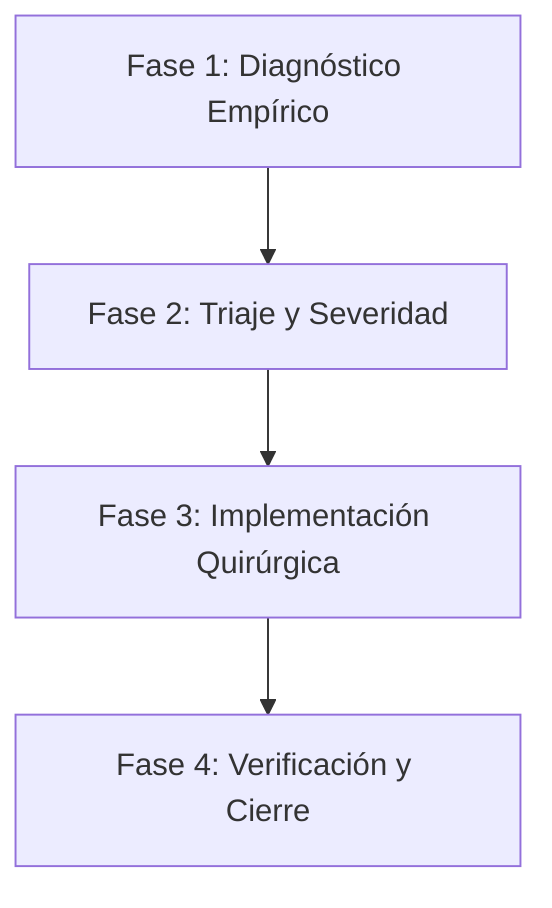

# Multi-Agent Engineering & Review Framework (AGENTS.md)
# Project: Myrtia (Agent-Native Red Teaming)

Este documento define la estructura de roles, procesos de revisión y estándares de calidad para el desarrollo y auditoría continua de **Myrtia**.

---

## 1. Filosofía de Trabajo y Postura de Revisión

1. **Rigor Técnico Objetivo**: Cero complacencia (*no sugarcoating*). Si algo está mal diseñado, acoplado, roto o mal optimizado, se señala de forma explícita, contundente y con evidencia técnica.
2. **Validación Empírica**: No se asume que algo funciona porque esté escrito en el código o en la documentación. Todo se comprueba mediante ejecución (tests, linter, inspección de rutas y comportamiento en runtime).
3. **Estándar Enterprise / Open Source**: El código debe cumplir estándares para ser auditado y probado por equipos de investigación externos (incluyendo IBM Research y la comunidad de seguridad de IA).

---

## 2. Roles de Agentes Especializados

Cuando operes o interactúes con el repositorio, adopta de manera explícita (o delega en) los siguientes roles según la tarea requerida:

### 🏛️ `[ARCHITECT / PROJECT MANAGER]`
* **Objetivo**: Asegurar la arquitectura a largo plazo, la modularidad y la escalabilidad.
* **Responsabilidades**:
  * Control del desacoplamiento entre el núcleo (`myrtia`), los plugins de ataque (ARES / `ares-council`) y la capa de almacenamiento.
  * Supervisión de la persistencia (transición de memoria a SQLite y estado de los eventos en el bus).
  * Evaluar el impacto de nuevas funcionalidades (p. ej. soporte MCP, agent skills, nuevos datasets) sobre el diseño del sistema.
* **Criterio de Aprobación**: Cero fugas de abstracción y contratos de interfaz limpios (`Protocol`, duck-typing defensivo).

### 🔍 `[STRICT CODE REVIEWER & QA]`
* **Objetivo**: Garantizar código limpio, idiomático, probado y libre de regresiones.
* **Responsabilidades**:
  * Ejecución y mantenimiento de `ruff check` (tolerancia cero a sentencias inline `;`, lambdas asignadas, imports muertos o variables ambiguas).
  * Cobertura de tests unitarios y BDD (`pytest -m "not e2e"`).
  * Detección de condiciones de carrera, errores de indexación, tipos inconsistentes y manejo pobre de excepciones (`except Exception: pass`).
* **Criterio de Aprobación**: `ruff check` con 0 warnings y suite de pruebas al 100% en verde.

### 🛡️ `[SECURITY & THREAT AUDITOR]`
* **Objetivo**: Blindar la seguridad del framework y verificar las salvaguardas de uso dual.
* **Responsabilidades**:
  * Prevención estricta de SSRF en conectores y proxies (respetando la regla de loopback y LAN pero bloqueando metadatos de nube).
  * Redacción y saneamiento de secretos (claves de API, cabeceras bearer) en logs, base de datos y eventos en vivo.
  * Verificación de que ningún prompt sensible o artefacto privado (`*.private.*`) se filtre en el build context de Docker o en Git.
  * Análisis de conformidad con OWASP LLM Top 10.
* **Criterio de Aprobación**: Ninguna credencial expuesta en plano y filtros SSRF herméticos.

### 🎨 `[FRONTEND & UX SPECIALIST]`
* **Objetivo**: Mantener la integridad y rendimiento de la interfaz *zero-build* (`standalone.html`).
* **Responsabilidades**:
  * Rendimiento del DOM y gestión de miles de nodos en ejecuciones largas.
  * Resiliencia de la conexión WebSocket (`/runs/{id}/events`): reconexión automática, manejo de desconexión sin bloquear el hilo del navegador.
  * Coherencia visual (estética oscura/clara, contraste WCAG, tokens de diseño).
  * Claridad de los mensajes de error: evitar que un fallo silencioso de red confunda al usuario.
* **Criterio de Aprobación**: Interfaz limpia, responsiva y con retroalimentación clara de estado para el operador.

### 🐳 `[DEVOPS & RUNTIME SPECIALIST]`
* **Objetivo**: Asegurar que Myrtia arranque sin fricción en cualquier entorno (macOS, Linux, Windows, Docker).
* **Responsabilidades**:
  * Optimización de imágenes en [Dockerfile](file:///c:/Users/marie/Documents/GitHub/myrtia/Dockerfile) (tamaño mínimo, capas cacheadas eficientes, ejecución como usuario no-root).
  * Redes en [compose.yaml](file:///c:/Users/marie/Documents/GitHub/myrtia/compose.yaml) (resolución de `host.docker.internal` vs `localhost`).
  * Arranque limpio y sincronización en [cli.py](file:///c:/Users/marie/Documents/GitHub/myrtia/backend/myrtia/cli.py) (evitar la apertura prematura del navegador y los errores 404).
* **Criterio de Aprobación**: Despliegue con un único comando reproducible en local y en CI.

---

## 3. Proceso Sistemático de Auditoría y Mejora

Cualquier revisión o refactorización debe seguir este protocolo en 4 fases:



1. **Fase 1: Diagnóstico Empírico (No asumir, comprobar)**:
   * Ejecutar suite de pruebas: `uv run --extra dev pytest -m "not e2e"`.
   * Ejecutar linter: `uv run --extra dev ruff check backend`.
   * Comprobar la respuesta real de los endpoints FastAPI y WebSockets.
2. **Fase 2: Triaje por Severidad**:
   * **Bloqueante / Crítico**: Fallos que rompen el primer arranque (ej. 404 inicial, crash de dependencias, bloqueo en bucle).
   * **Alto**: Inconsistencias de red (Docker vs host), fugas de datos o bugs en exportación (Excel, CSV).
   * **Medio**: Deuda técnica, linter roto, falta de compresión GZip o rutas rígidas.
   * **Bajo / Mejora**: Pulido de estilos visuales, helpers explicativos, comentarios desfasados.
3. **Fase 3: Implementación Quirúrgica**:
   * Modificar únicamente el código estrictamente necesario preservando comentarios y arquitectura previa.
4. **Fase 4: Verificación y Cierre**:
   * Re-ejecutar linter y tests.
   * Verificar en navegador o mediante subagentes la correcta respuesta del cambio.

---

## 4. Instrucción Directa para el Asistente

Al recibir una tarea de revisión o desarrollo en este repositorio:
1. Actúa bajo el rol o combinación de roles correspondiente.
2. Identifica proactivamente cualquier punto débil, bug o degradación del rendimiento.
3. No des por bueno un cambio sin validar su ejecución práctica.
4. Sé directo, transparente y riguroso.

---

## 5. Registro de Hallazgos y Auditoría Técnica (Audit Log)

### 🐞 `[BUG-FE-01]` Bloqueo de hover y clicks en botón "Done" con ventana estrecha / split screen
* **Rol Asignado**: 🎨 `[FRONTEND & UX SPECIALIST]`
* **Severidad**: Alta (Bloquea la interacción del usuario en pantallas divididas o resoluciones estrechas).
* **Ubicación**: [standalone.html](file:///c:/Users/marie/Documents/GitHub/myrtia/frontend/standalone.html) (Módulo Tour en líneas 3270-3385 y diálogos flotantes en líneas 636-645).
* **Síntoma Reportado**: Al anclar la ventana a la izquierda (Windows Snap / ancho reducido), el botón **"Done"** queda inaccesible: no responde al hover, no muestra el cursor `pointer` ("la manita") y los clics no surten efecto. En pantalla normal o maximizada sí funciona.
* **Diagnóstico y Causa Raíz**:
  1. **Capa invisible interceptora (*Phantom Click-Trap*)**:
     El elemento modal `.tourMock` ([standalone.html:3284](file:///c:/Users/marie/Documents/GitHub/myrtia/frontend/standalone.html#L3284)) se crea con `position: fixed; z-index: 10001; left: 50%; top: 50%; transform: translate(-50%, -50%); width: 470px; opacity: 0;`. Cuando no está visible, el código simplemente remueve la clase `.tourShow` (dejándolo en `opacity: 0`), pero **omite declarar `pointer-events: none` o `display: none`**.
     En una ventana maximizada, los botones laterales quedan fuera del centro de la pantalla; sin embargo, al acoplar la ventana a la mitad izquierda de la pantalla (~800px a 960px de ancho), una caja invisible de 470px centrada cubre más del 50% de todo el ancho visible, "tragándose" todos los eventos del cursor sobre cualquier elemento situado debajo.
  2. **Colisión de coordenadas y Stacking Context en `.gdialog`**:
     Si el diálogo es el editor de nodos del canvas ([standalone.html:645](file:///c:/Users/marie/Documents/GitHub/myrtia/frontend/standalone.html#L645)), la regla `@media (max-width: 820px)` fuerza `.gdialog { left: 12px !important; right: 12px; width: auto; }` sin recalcular el `top` ni dotar al contenedor de scroll vertical (`overflow-y: auto; max-height: calc(100vh - ...)`). La barra inferior de acciones `.gd-acts` (donde reside el botón "Done") queda solapada bajo la barra de navegación fija inferior `.rail` (`z-index: 19`, `bottom: 0`, `height: 64px`) o bajo los elementos flotantes (`#chatFab`, `z-index: 60`), impidiendo que el evento de ratón alcance el botón.
* **Estado**: Resuelto y Verificado.
* **GitHub Issue**: [#51](https://github.com/francordel/myrtia/issues/51)
* **Pull Request**: [#54](https://github.com/francordel/myrtia/pull/54)

### 🐞 `[BUG-FE-02]` Flecha verde de feedback loop huérfana apuntando al vacío en el canvas
* **Rol Asignado**: 🎨 `[FRONTEND & UX SPECIALIST]` / 🏛️ `[ARCHITECT]`
* **Severidad**: Media (Degrada la claridad visual y da sensación de interfaz rota/incompleta ante revisores externos).
* **Ubicación**: [standalone.html:2846-2848](file:///c:/Users/marie/Documents/GitHub/myrtia/frontend/standalone.html#L2846-L2848) (Función `renderGraph()`).
* **Síntoma Reportado**: En el canvas de topología, al tener múltiples turnos (`Turns > 1`), aparece una flecha verde discontinua que sale del nodo `EVALUATOR`, hace una curva descendente hacia la izquierda y termina flotando en mitad del lienzo apuntando a la nada, sin anclarse a ningún nodo atacante.
* **Diagnóstico y Causa Raíz**:
  1. **Coordenadas de destino estáticas y ciegas (`Hardcoded Void Coordinates`)**:
     En las líneas 2847-2848, el código intenta dibujar el bucle de retroalimentación multi-turno (*multi-turn feedback loop*) desde el juez hacia el consejo atacante:
     ```javascript
     if(GS.turns > 1){
       const bot = H - 14, endX = pos.ring.cx, endY = pos.ring.show ? pos.ring.cy + pos.ring.ry + 40 : pos.ring.cy + 44;
       e += `<path class="e-judge" d="M${pos.evaluator.x-76},${pos.evaluator.y} C${pos.evaluator.x-200},${bot} ${endX+140},${bot} ${endX},${endY}" marker-end="url(#garrow)"/>`;
     }
     ```
  2. **Desconexión con la topología real**:
     El cálculo de `endX` y `endY` asume rígidamente una elipse geométrica matemática teórica (`pos.ring.cx, pos.ring.cy + 44`).
     * Si el usuario mueve los nodos, añade atacantes o entra en modo `custom`, `pos.ring` no representa a los nodos reales.
     * La flecha no se calcula mediante el algoritmo de aristas del grafo (`gLine()` o `gClip()`), sino como un trazado SVG curvo arbitrario que apunta a un punto fijo `(endX, endY)` donde no hay ningún nodo receptor, quedando como una flecha huérfana.
* **Comportamiento Esperado**:
  La flecha de retroalimentación debe conectarse explícitamente al nodo atacante activo (o al conjunto de atacantes) mediante sus puertos de entrada, o dirigirse al centroide de la agrupación si existe un anillo visual, pero jamás terminar en coordenadas absolutas vacías.
* **Estado**: Resuelto y Verificado.
* **GitHub Issue**: [#52](https://github.com/francordel/myrtia/issues/52)
* **Pull Request**: [#55](https://github.com/francordel/myrtia/pull/55)

### 🐞 `[BUG-FE-03]` Imposibilidad de hacer scroll hasta el final en ventana reducida / móvil (Corte por bottom rail)
* **Rol Asignado**: 🎨 `[FRONTEND & UX SPECIALIST]`
* **Severidad**: Alta (Oculta completamente el selector de objetivos `Choose goals from the library`, datasets y controles inferiores).
* **Ubicación**: [standalone.html:58](file:///c:/Users/marie/Documents/GitHub/myrtia/frontend/standalone.html#L58) y [standalone.html:658-664](file:///c:/Users/marie/Documents/GitHub/myrtia/frontend/standalone.html#L658-L664).
* **Síntoma Reportado**: Al reducir el ancho de la ventana o usar pantalla dividida (breakpoint `<= 820px`), el usuario no puede hacer scroll hasta el final de la página. Aunque la barra de scroll llegue al 100% abajo, el contenido inferior (`glibwrap` / selector de goals de la librería) queda físicamente tapado y cortado por la barra de navegación fija inferior (`.rail`).
* **Diagnóstico y Causa Raíz**:
  1. **Incompatibilidad de `html, body { height: 100% }` con `padding-bottom` en `body`**:
     En la línea 58 se define `html,body { height:100%; }`. Cuando `height: 100%` está activo, la caja del `body` queda anclada al alto del viewport.
     En la línea 658, `@media (max-width:820px)` define `body { padding-bottom: 76px; }`, pero en los motores Chromium/WebKit el scroll se delega al `document.documentElement` o desborde de hijos, ignorando el `padding-bottom` del `body` para el cálculo del final de carrera del scroll.
  2. **Ausencia de `padding-bottom` en `main`**:
     El contenedor del contenido real es `<main>` ([standalone.html:661](file:///c:/Users/marie/Documents/GitHub/myrtia/frontend/standalone.html#L661)), que define `main { padding: var(--sp-3); }` (12px en todos los lados).
     La barra de navegación `.rail` tiene `height: 64px; position: fixed; bottom: 0;`, y el botón `#chatFab` ocupa `bottom: 80px`. Al no tener `main` un `padding-bottom` de al menos `96px` a `120px`, el último elemento del DOM queda indefectiblemente solapado por debajo de la barra fija sin posibilidad de alcanzarlo con el scroll.
* **Comportamiento Esperado**:
  Al llegar al final del scroll, debe haber suficiente holgura inferior para que el último componente (`.graph-goals` / `glibwrap` y los botones de acción) quede completamente por encima de la barra `.rail` y del botón flotante `#chatFab`.
* **Estado**: Resuelto y Verificado.
* **GitHub Issue**: [#53](https://github.com/francordel/myrtia/issues/53)
* **Pull Request**: [#56](https://github.com/francordel/myrtia/pull/56)

### 🐞 `[BUG-BE-01]` Fallo de validación Pydantic por falta de `input_path` por defecto en CouncilAttack
* **Rol Asignado**: 🏛️ `[ARCHITECT]` / 🔍 `[STRICT CODE REVIEWER & QA]`
* **Severidad**: Alta (Bloquea la instanciación de `council` y `council-crescendo` si no se pasa `input_path` explícito).
* **Ubicación**: [council.py:120-124](file:///c:/Users/marie/Documents/GitHub/myrtia/backend/myrtia/plugins/council.py#L120-L124).
* **Diagnóstico**: La clase base ARES `AttackStrategyConfig` exige obligatoriamente el campo `input_path`. Myrtia define un `output_path` por defecto pero omite `input_path`. Como Myrtia carga los objetivos en memoria vía `load_goals()`, cualquier instanciación directa del factory sin `input_path` en `config` lanza `1 validation error for AttackStrategyConfig: input_path: Field required`.
* **Estado**: Resuelto y Verificado.
* **GitHub Issue**: [#57](https://github.com/francordel/myrtia/issues/57)
* **Pull Request**: [#65](https://github.com/francordel/myrtia/pull/65)

### 💡 `[UX-FE-01]` Paso 4 (Council) permanentemente visible en modo Standard para ataques individuales
* **Rol Asignado**: 🎨 `[FRONTEND & UX SPECIALIST]`
* **Severidad**: Media (Induce a error al operador haciendo creer que un ataque Base64 o plantilla DAN utiliza un consejo multi-agente).
* **Ubicación**: [standalone.html:877-889](file:///c:/Users/marie/Documents/GitHub/myrtia/frontend/standalone.html#L877-L889).
* **Diagnóstico**: El contenedor `#councilSec` se muestra sin importar el ataque seleccionado en el Paso 1. Debe ocultarse automáticamente si el plugin de ataque seleccionado no utiliza agentes deliberativos.
* **Estado**: Resuelto y Verificado.
* **GitHub Issue**: [#58](https://github.com/francordel/myrtia/issues/58)
* **Pull Request**: [#66](https://github.com/francordel/myrtia/pull/66)

### 💡 `[UX-FE-02]` Texto contradictorio en el cajón de contexto del objetivo (Crescendo vs Priming vs Isolated)
* **Rol Asignado**: 🎨 `[FRONTEND & UX SPECIALIST]`
* **Severidad**: Media (Confunde al usuario afirmando que el target empieza limpio incluso al activar Crescendo).
* **Ubicación**: [standalone.html:758-766](file:///c:/Users/marie/Documents/GitHub/myrtia/frontend/standalone.html#L758-L766).
* **Diagnóstico**: La nota estática `#gModeNote` dice *"The target starts fresh"* de forma invariable. Si el usuario activa Crescendo, el target acumula el historial real de conversación. La nota debe ser dinámica y reflejar con fidelidad el modo seleccionado (Isolated, Crescendo o Contextual priming).
* **Estado**: Resuelto y Verificado.
* **GitHub Issue**: [#59](https://github.com/francordel/myrtia/issues/59)
* **Pull Request**: [#67](https://github.com/francordel/myrtia/pull/67)

### 💡 `[UX-FE-03]` Campo de texto mágico "off" para desactivar el evaluador en el constructor de ataques
* **Rol Asignado**: 🎨 `[FRONTEND & UX SPECIALIST]`
* **Severidad**: Baja (Mala práctica de UX que genera errores tipográficos al desactivar el juez).
* **Ubicación**: [standalone.html:819-826](file:///c:/Users/marie/Documents/GitHub/myrtia/frontend/standalone.html#L819-L826).
* **Diagnóstico**: Desactivar el juez en modo Standard exige escribir literalmente `"off"` en el campo de texto del modelo del evaluador. Debe reemplazarse por un interruptor nativo `[x] Enable Evaluator`.
* **Estado**: Resuelto y Verificado.
* **GitHub Issue**: [#60](https://github.com/francordel/myrtia/issues/60)
* **Pull Request**: [#68](https://github.com/francordel/myrtia/pull/68)

### 🐞 `[BUG-BE-02]` Invocaciones secundarias o imports a `myrtia.store.runs` corrompen ejecuciones activas en SQLite
* **Rol Asignado**: 🏛️ `[ARCHITECT]` / 🔍 `[STRICT CODE REVIEWER & QA]`
* **Severidad**: Crítica (Cualquier comando CLI, script secundario o worker mata silenciosamente todas las ejecuciones concurrentes en vuelo).
* **Ubicación**: [runs.py:165-175](file:///c:/Users/marie/Documents/GitHub/myrtia/backend/myrtia/store/runs.py#L165-L175) (`RunStore._load()`).
* **Diagnóstico**: La instancia singleton `STORE = RunStore()` se ejecuta en el tiempo de importación del módulo. Su método interno `_load()` asume incondicionalmente que el proceso actual es el servidor arrancando tras un apagón, por lo que itera la tabla de SQLite y conmuta cualquier ejecución que esté en estado `RUNNING` o `PENDING` a `FAILED` con el mensaje `"interrupted (backend restarted)"` y lo persiste de vuelta en base de datos. Si un script o comando CLI importa el módulo mientras el servidor web procesa un ataque multi-turno, la ejecución activa es abortada y marcada erróneamente como fallida.
* **Comportamiento Esperado**: La detección y limpieza de ejecuciones huérfanas sólo debe efectuarse cuando se invoca explícitamente en el ciclo de vida del servidor principal (lifespan), o comprobando previamente la liveness del PID/proceso registrado.
* **Estado**: Resuelto y Verificado.
* **GitHub Issue**: [#61](https://github.com/francordel/myrtia/issues/61)
* **Pull Request**: [#69](https://github.com/francordel/myrtia/pull/69)

### 🐞 `[BUG-FE-04]` Pestaña "Runs" en la barra de navegación bloqueada en vista `#runHead` sin reseteo al builder
* **Rol Asignado**: 🎨 `[FRONTEND & UX SPECIALIST]`
* **Severidad**: Media (Rompe el flujo de interacción habitual: el usuario hace clic en "Runs" esperando regresar al Attack Builder y se queda atrapado en los resultados del run anterior).
* **Ubicación**: [standalone.html:2085-2096](file:///c:/Users/marie/Documents/GitHub/myrtia/frontend/standalone.html#L2085-L2096) y [standalone.html:2195-2197](file:///c:/Users/marie/Documents/GitHub/myrtia/frontend/standalone.html#L2195-L2197).
* **Diagnóstico**: Al hacer clic en `.railbtn[data-view="view-run"]`, la función `showView("view-run")` únicamente desoculta el contenedor `#view-run`. Si la variable global `RUN` contiene un run finalizado, el panel `#runHead` y la vista de streaming se mantienen activos sobre el canvas y el builder. El usuario está obligado a localizar el botón secundario `← Agent graph` / `← Standard setup` o navegar a otra pestaña.
* **Comportamiento Esperado**: Si el usuario pulsa en el botón "Runs" de la barra lateral mientras visualiza un ataque ya completado, o para iniciar una nueva configuración, debe invocar de forma inteligente `returnToBuilder()` para limpiar la vista y presentar de nuevo el Attack Builder limpio.
* **Estado**: Resuelto y Verificado.
* **GitHub Issue**: [#62](https://github.com/francordel/myrtia/issues/62)
* **Pull Request**: [#70](https://github.com/francordel/myrtia/pull/70)

### 💡 `[UX-FE-04]` Límite de contexto en vLLM / modelos pequeños durante ataques multi-turno Crescendo
* **Rol Asignado**: 🏛️ `[ARCHITECT]` / 🐳 `[DEVOPS & RUNTIME SPECIALIST]`
* **Severidad**: Media (Produce errores HTTP 400 en ataques con más de 2 turnos si no se dimensiona el context length).
* **Ubicación**: Servidor de inferencia vLLM y cálculo de historial en `CouncilAttack`.
* **Diagnóstico**: Al configurar ataques de tipo Crescendo acumulativo con `--max-model-len 4096`, el historial de conversación acumulado más las propuestas y plantillas de los atacantes excede los 4K tokens en el Turno 2, provocando que vLLM rechace la petición con `400 Bad Request: context length exceeded`.
* **Resolución Recomendada**: Configurar los servidores de modelos en clúster/local con un contexto mínimo de 16,384 tokens (`--max-model-len 16384`) para modelos que lo soporten (como la familia Qwen2.5), y añadir en el frontend un indicador de longitud estimada de contexto al activar Crescendo.
* **Estado**: Resuelto y Verificado.
* **GitHub Issue**: [#63](https://github.com/francordel/myrtia/issues/63)
* **Pull Request**: [#71](https://github.com/francordel/myrtia/pull/71)

### 🧹 `[CODE-BE-01]` Deuda técnica de linter (23 errores en `ruff check backend`)
* **Rol Asignado**: 🔍 `[STRICT CODE REVIEWER & QA]`
* **Severidad**: Baja / Deuda Técnica (Viola la directriz de tolerancia cero a advertencias del linter establecida en AGENTS.md).
* **Ubicación**: Módulos `audit.py`, `stats.py`, `connectors/base.py`, `defenses.py`, `orchestrator/runner.py`, `plugins/council_prompts.py`, `plugins/garak_probes.py` y `vendor/ares-council`.
* **Diagnóstico**: Existen 23 infracciones de estilo y código muerto: sentencias múltiples en una línea separadas por punto y coma (E702), asignación de lambdas a variables en lugar de funciones `def` (E731), f-strings sin interpolación (F541), imports huérfanos sin uso (F401), importaciones fuera del encabezado (E402) y variables ambiguas `l` (E741).
* **Comportamiento Esperado**: `uv run --extra dev ruff check backend` debe reportar 0 errores y 0 warnings.
* **Estado**: Resuelto y Verificado.
* **GitHub Issue**: [#64](https://github.com/francordel/myrtia/issues/64)
* **Pull Request**: [#72](https://github.com/francordel/myrtia/pull/72)

### 🛡️ `[SEC-BE-01]` Vulnerabilidad de inyección de fórmulas CSV (CWE-1236 / CSV Formula Injection)
* **Rol Asignado**: 🛡️ `[SECURITY & THREAT AUDITOR]`
* **Severidad**: Alta / Seguridad (Riesgo de ejecución de código arbitrario vía DDE o macros en clientes Excel/Calc al abrir exportaciones de ataques).
* **Ubicación**: [runs.py:214-228](file:///c:/Users/marie/Documents/GitHub/myrtia/backend/myrtia/api/routers/runs.py#L214-L228) (`/runs/{id}/export?format=csv`).
* **Diagnóstico**: Las columnas `prompt`, `response`, `goal` y `title` se exportan directamente sin sanear a través de `csv.writer`. En campañas de red teaming, prompts adversariales o respuestas generadas por modelos atacados pueden comenzar por caracteres de control de fórmulas (`=`, `+`, `-`, `@`, `\t`, `\r`). Al abrir el archivo CSV exportado en Microsoft Excel o LibreOffice, la aplicación interpreta el contenido como fórmulas de hoja de cálculo o comandos Dynamic Data Exchange (DDE).
* **Comportamiento Esperado**: Todo campo de texto que comience por caracteres disparadores de fórmulas debe sanearse o prefijarse con apóstrofe (`'`) para neutralizar la ejecución de fórmulas en hojas de cálculo.
* **Estado**: Identificado y Documentado (Issue Creado).
* **GitHub Issue**: [#73](https://github.com/francordel/myrtia/issues/73)

### 🐞 `[BUG-BE-03]` Deadlock y congelación de ejecuciones canceladas en estado `WAITING_APPROVAL`
* **Rol Asignado**: 🏛️ `[ARCHITECT]` / 🔍 `[STRICT CODE REVIEWER & QA]`
* **Severidad**: Alta (Bloquea la cancelación de ataques y deja tareas asíncronas colgadas en memoria indefinidamente).
* **Ubicación**: [runner.py:40-46](file:///c:/Users/marie/Documents/GitHub/myrtia/backend/myrtia/orchestrator/runner.py#L40-L46) y [approvals.py:66-77](file:///c:/Users/marie/Documents/GitHub/myrtia/backend/myrtia/hitl/approvals.py#L66-L77).
* **Diagnóstico**: Cuando una ejecución requiere aprobación humana (`require_approval: true`), el orchestrator queda esperando `await approval.future`. Si el operador envía `POST /runs/{id}/cancel`, el método `Orchestrator.cancel()` activa `cancel_ev.set()`, pero no cancela ni rechaza `approval.future`. La corrutina queda en espera infinita del futuro de aprobación, la ejecución permanece atrapada en `waiting_approval` y nunca transiciona a `cancelled`.
* **Comportamiento Esperado**: Al cancelar un ataque, `cancel()` debe resolver con `False` o cancelar cualquier aprobación pendiente asociada al `run_id`, liberando la tarea inmediatamente.
* **Estado**: Identificado y Documentado (Issue Creado).
* **GitHub Issue**: [#74](https://github.com/francordel/myrtia/issues/74)

### 🐞 `[BUG-BE-04]` Pérdida de persistencia de `token_usage` en SQLite entre reinicios del backend
* **Rol Asignado**: 🏛️ `[ARCHITECT]` / 🔍 `[STRICT CODE REVIEWER & QA]`
* **Severidad**: Media (Pérdida de métricas de contabilidad y consumo de tokens al reiniciar el servidor).
* **Ubicación**: [runs.py:183-187](file:///c:/Users/marie/Documents/GitHub/myrtia/backend/myrtia/store/runs.py#L183-L187) y [db.py:64-92](file:///c:/Users/marie/Documents/GitHub/myrtia/backend/myrtia/store/db.py#L64-L92).
* **Diagnóstico**: Al completarse un run, el runner calcula el consumo de tokens del target en `run.token_usage = {"target": dict(tk)}`. Sin embargo, `RunStore.persist()` invoca `db.save_run()` omitiendo este diccionario. La tabla de SQLite no posee columna para `token_usage` y `load_runs()` nunca lo recupera, por lo que las estadísticas de tokens desaparecen de History tras reiniciar el proceso backend.
* **Comportamiento Esperado**: `token_usage` debe persistirse en SQLite y rehidratarse en `load_runs()` para conservar la métrica de consumo tras reinicios.
* **Estado**: Identificado y Documentado (Issue Creado).
* **GitHub Issue**: [#75](https://github.com/francordel/myrtia/issues/75)

### 💡 `[UX-FE-05]` Supresión de mensajes de error de la API en el frontend (`toast genérico HTTP status`)
* **Rol Asignado**: 🎨 `[FRONTEND & UX SPECIALIST]`
* **Severidad**: Media (Degrada la experiencia del operador ocultando el motivo real del fallo).
* **Ubicación**: [standalone.html:1881](file:///c:/Users/marie/Documents/GitHub/myrtia/frontend/standalone.html#L1881) y [standalone.html:3231](file:///c:/Users/marie/Documents/GitHub/myrtia/frontend/standalone.html#L3231).
* **Diagnóstico**: Al rechazar el backend un lanzamiento (`POST /runs` con código 400 o 422), el frontend sólo lee `res.status` y muestra `toast("Launch failed (HTTP " + res.status + ").", "err")`, descartando el cuerpo JSON. Si el servidor rechazó la llamada por bloqueo SSRF de metadatos de nube, por modelo ausente o por error de validación, el operador no recibe información útil.
* **Comportamiento Esperado**: Extraer y mostrar `data.error` o `data.detail` devuelto por FastAPI en el mensaje toast para guiar al usuario.
* **Estado**: Identificado y Documentado (Issue Creado).
* **GitHub Issue**: [#76](https://github.com/francordel/myrtia/issues/76)

### 🛡️ `[SEC-FE-01]` Instalación desatendida de paquetes (`pip install`) sin confirmación en el asistente de chat
* **Rol Asignado**: 🛡️ `[SECURITY & THREAT AUDITOR]` / 🎨 `[FRONTEND & UX SPECIALIST]`
* **Severidad**: Media / Seguridad (Riesgo de ejecución desatendida por inyección indirecta de prompt).
* **Ubicación**: [standalone.html:2373-2375](file:///c:/Users/marie/Documents/GitHub/myrtia/frontend/standalone.html#L2373-L2375).
* **Diagnóstico**: A diferencia de la pestaña Plugins donde la instalación de toolkits exige confirmación nativa mediante `confirm(...)`, si el modelo del asistente emite un bloque ` ```myrtia-install { "pack": "..." }``` `, el frontend dispara de forma invisible e inmediata `installPackById(pid)` realizando un `pip install` en el servidor backend sin confirmación alguna del usuario.
* **Comportamiento Esperado**: Cualquier sugerencia de instalación procedente del LLM debe mostrar un botón interactivo para que el operador confirme expresamente antes de invocar la API de instalación.
* **Estado**: Identificado y Documentado (Issue Creado).
* **GitHub Issue**: [#77](https://github.com/francordel/myrtia/issues/77)


