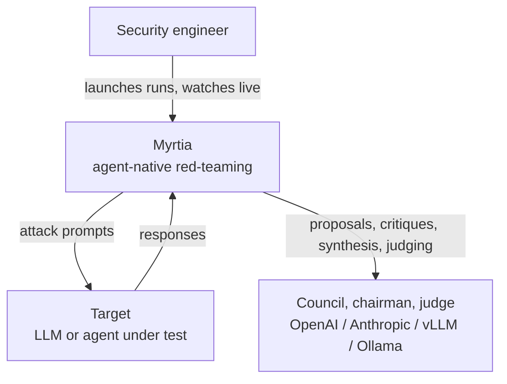
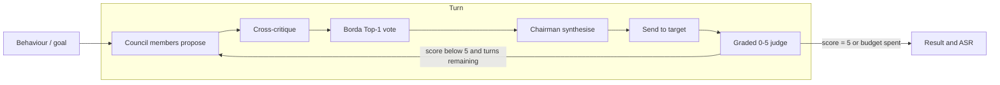
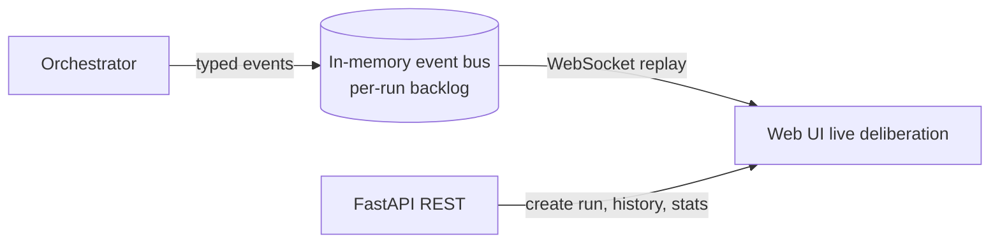

<div align="center">

<picture>
  <source media="(prefers-color-scheme: dark)" srcset="docs/logo-dark.png" />
  
</picture>

# MYRTIA

**Agent-native red teaming for large language models and AI agents.**

[](LICENSE)
[](BACKLOG.md)
[](backend/pyproject.toml)
[](https://github.com/IBM/ares)

*A council of attacker models deliberates, votes and strikes — and you watch it live.*

<br />


</div>

---

## Table of Contents

- [Overview](#overview)
- [Why Myrtia](#why-myrtia)
- [Features](#features)
- [Current Capability Boundaries](#current-capability-boundaries)
- [Architecture](#architecture)
- [Quick Start](#quick-start)
- [Attacks](#attacks)
- [Configuration](#configuration)
- [Extending Myrtia](#extending-myrtia)
- [Red teaming as a service](#red-teaming-as-a-service)
- [Roadmap](#roadmap)
- [Built On](#built-on)
- [Responsible Use](#responsible-use)
- [License](#license)

## Overview

Myrtia is an open-source framework for **red teaming large language models and AI agents**.
Rather than a single attacker, it orchestrates a **council** of models that independently
propose adversarial prompts, cross-critique one another, and vote (via Borda aggregation) on the
strongest candidate. A chairman synthesises the winning proposal, the resulting prompt is sent
to the target model, and an in-loop judge grades the outcome on a 0–5 harm scale. The entire
deliberation is **streamed to a web interface in real time**, turn by turn, and every run rolls
up into Attack Success Rate (ASR) analytics.

Library and CLI tools such as IBM **ARES** and NVIDIA **garak** are the reference point for LLM
red teaming. Myrtia takes the same rigour but is built around **autonomous multi-agent
attackers**, and it ships with a real front-end and analytics so that operators can observe an
attack as it unfolds and reason about *why* a target held or failed, not just whether it did.

### How Myrtia compares

| Capability | garak / PyRIT / ARES | promptfoo | Mindgard / Splx / Repello | Myrtia |
|---|:--:|:--:|:--:|:--:|
| Open source | Yes | Yes | No (SaaS) | Yes (Apache-2.0) |
| Self-hosted | Yes | Yes | No | Yes |
| Attack-strategy library | Yes | Yes | Yes | Yes (ARES + garak probes) |
| **Multi-agent attacker _council_** (propose → cross-critique → Borda vote → chairman synthesis) | — | — | — | **Yes** |
| **Visual agentic-attack builder** (compose attacker nodes, topology and per-node model/persona on a canvas) | — | — | — | **Yes** |
| Live deliberation UI (per-turn proposals, votes, judge rationale) | — | Dashboards | Dashboards | Yes |
| Chainable defense pipelines (shields) | — | — | Partial | Planned |

The two bold rows are Myrtia's differentiators: no other tool pairs a deliberating **council with
Borda voting and chairman synthesis** with an **open-source visual canvas for composing the
agentic attack**. The closest neighbours sit in only one dimension — multi-agent attacker research
(e.g. X-Teaming, a fixed Planner/Attacker/Verifier pipeline) or generic visual agent builders
(LangGraph Studio, Langflow), which are not red-teaming tools. (SaaS platforms compared from their
public descriptions.)

### The name and the mark

The name Myrtia (Latin *Myrtea*, "place of myrtles"; the Roman goddess *Murcia*) is the ancient
root of the name of the city of Murcia. It is a tool from the *huerta*, aimed at the frontier.

The logo carries the same idea in one image. It is a **myrtle leaf** — the plant that gives
Myrtia and Murcia their name, our roots in the *huerta* — and, at the same time, a **shield
cracked open by our attacks**. Defence and offence in a single mark: the shield is what an
aligned model puts up, and the break is what a deliberating council of attackers finds in it.
The heritage is deliberately Spanish — a *rodela*, the round shield of the Tercios — reclaimed
for AI security research from Murcia, in the spirit of turning a frontier tool outward at the
frontier models. A tool from the *huerta*, forged as a broken shield, pointed at the strongest
systems we can reach.

Red teaming in Myrtia is organised around four components:

- **Attacks** define how adversarial prompts are generated: a deliberating council, a crescendo
  escalation, or a direct baseline.
- **Targets** are the model or agent under test, reached through any OpenAI-compatible endpoint.
- **Judge and scoring** grade each response on a graded 0–5 scale and aggregate it into ASR.
- **Behaviours** are what you attack: a built-in HarmBench library selectable by theme, or your
  own goals.

## Why Myrtia

- **Deliberation beats a lone attacker.** Multiple models proposing and critiquing surface
  attack angles a single model misses; Borda voting selects the strongest, and a chairman
  refines it before it ever reaches the target.
- **Observability is the product.** Red-team results are only trustworthy if they are
  legible and reproducible. Myrtia shows every proposal, every vote, every judge rationale.
- **Attacker/target separation.** Safety-aligned frontier models refuse to author jailbreaks,
  so Myrtia pairs a permissive open-model council with the frontier target under test — the
  realistic threat model, and the one that actually produces signal.
- **Permissive and self-hosted.** Apache-2.0, runs on your own machine, mixes any providers, and
  never returns API keys through the API or the event stream.

## Features

- **Live CouncilAttack.** N proposer models propose, cross-critique, vote (Borda Top-1), a
  chairman synthesises, and an in-loop judge grades — rendered live over WebSocket, turn by turn.
- **Multiple attack strategies.** `council`, `council-crescendo` (accumulating multi-turn
  escalation), and `direct` (baseline), each exposing its own advanced configuration in the UI.
- **Behaviour library.** 278 HarmBench behaviours across five themes, selectable via per-theme
  checkboxes and search, or replaced entirely by your own goals.
- **Provider-agnostic connectors.** OpenAI, Anthropic (OpenAI-compatible endpoint), self-hosted
  vLLM, and local Ollama, mixed freely across council, chairman, judge, and target roles.
- **Analytics dashboard.** ASR broken down by attack, target model, and theme; judge-score
  distribution; and, for council attacks, per-member vote win-rates and average Borda scores.
- **Searchable run history.** Every run is filterable by goal text, theme, result, and evaluation
  score, and can be reopened to replay its full deliberation.
- **Legible deliberation view.** Per-goal and per-turn cards, Borda vote tables, and read-more
  and collapse controls throughout, in dark or light themes.
- **Plugin architecture.** Attacks, targets, and judges are plugins; the attack contract is
  ARES-compatible, so existing ARES strategies can be hosted with minimal adaptation.
- **Security-conscious by default.** API keys are supplied at run time and are redacted from all
  API responses and from the live event stream.
- **Self-hosted and permissive.** Apache-2.0, single-command backend, no vendor lock-in.

## Current Capability Boundaries

Myrtia is in **alpha**. Being explicit about what it is and is not today:

- Attack coverage is CouncilAttack (isolated and crescendo) plus a direct baseline. The broader
  ARES/garak catalogue (echo-chamber, TAP, AutoDAN, GCG, and others) is planned, not shipped.
- Storage is **in-memory and single-process**. Run history and the statistics dashboard reset on
  backend restart; a durable SQLite backing is on the roadmap.
- There is **no run cancellation** and **no built-in authentication** yet; Myrtia is intended for
  local, single-operator use behind your own controls.
- Judge quality is load-bearing: a weak judge inflates ASR with false positives. Use a capable
  model as judge, and treat scores from small local judges as indicative only.
- Myrtia is a **red-teaming** tool for probing models and agents. It is not a network penetration
  testing platform and ships no offensive network tooling.

## Architecture



<details>
<summary><b>Council deliberation flow</b> (click to expand)</summary>


</details>

<details>
<summary><b>Live event flow</b> (click to expand)</summary>



Event types: `run.started`, `goal.started`, `turn.started`, `proposal.created`,
`critique.created`, `vote.aggregated`, `chairman.synthesized`, `target.responded`,
`judge.scored`, `run.finished`.
</details>

<details>
<summary><b>Repository layout</b> (click to expand)</summary>

```
backend/   Python, FastAPI + WebSocket
  myrtia/orchestrator   drives a run, streams events
  myrtia/plugins        attacks (ARES-compatible): council / council-crescendo / direct
  myrtia/connectors     OpenAI-compatible target connectors
  myrtia/events         typed event schema + thread-safe bus (the live-view contract)
  myrtia/judges         graded harm judge and scoring
  myrtia/data           HarmBench behaviour library
  myrtia/api            REST control + /runs/{id}/events WebSocket
  vendor/ares-council   vendored CouncilAttack plugin (Apache-2.0)
frontend/  web UI (live deliberation, history, behaviour library, dashboard)
docs/      architecture and reference maps
```
</details>

See [`docs/architecture.md`](docs/architecture.md) for the full design.

## Quick Start

Requirements: **Python 3.11+** (and, optionally, a local [Ollama](https://ollama.com) with a
small model to watch a council deliberate with no API key).

**1 · Create a virtual environment and install** — pick your OS:

<details open>
<summary><b>macOS / Linux</b> (bash / zsh)</summary>

```bash
cd backend
python3 -m venv .venv && source .venv/bin/activate
pip install -e .
pip install -e vendor/ares-council        # the CouncilAttack plugin (Apache-2.0)
```
</details>

<details>
<summary><b>Windows · PowerShell</b></summary>

```powershell
cd backend
py -m venv .venv
.\.venv\Scripts\Activate.ps1               # if blocked: Set-ExecutionPolicy -Scope Process RemoteSigned
pip install -e .
pip install -e vendor/ares-council         # the CouncilAttack plugin (Apache-2.0)
```
</details>

<details>
<summary><b>Windows · Command Prompt (cmd)</b></summary>

```bat
cd backend
py -m venv .venv
.venv\Scripts\activate.bat
pip install -e .
pip install -e vendor/ares-council
```
</details>

**2 · Run the server** (serves the API and the web UI) — all platforms:

```bash
uvicorn myrtia.api.app:app --port 8000
```

**3 · Open the console** at **http://127.0.0.1:8000/**

| OS | Command |
| --- | --- |
| macOS | `open http://127.0.0.1:8000/` |
| Linux | `xdg-open http://127.0.0.1:8000/` |
| Windows | `start http://127.0.0.1:8000/` |

In the UI, pick an attack, choose a target (OpenAI-compatible base URL and model), select
behaviours from the library or type a goal, and launch. The deliberation streams in live, the
run lands in History. Only runs marked **Security evaluation** feed the Statistics
dashboard and audit exports by default; the harmless starter goal is a **Smoke test**.
Older runs remain **Unreviewed** until you classify them in the run detail. Judge
scores are automatic signals, not confirmed vulnerabilities.

HarmBench goals are included. In **Plugins → Goal datasets**, download JailbreakBench,
AdvBench or StrongREJECT to add their goals to both run modes. Search and filter by
dataset and category in Runs. See [goal dataset sources and scope](docs/goal-datasets.md).

## Configuration

Recommended setup — the council configuration from the paper: a local open-weight
council attacking a frontier target.

| Role | Paper setup |
| --- | --- |
| Council (attackers) | `qwen3:14b`, `gemma3:12b`, `deepseek-r1:32b` on local Ollama |
| Chairman | `qwen2.5:32b` |
| Judge | a strong model (the paper uses `gpt-oss:120b` via an OpenAI-compatible endpoint) |
| Target | the frontier model under test |

These are the models the paper's attacks were run with. Smaller models work for a quick
smoke test, but the open-weight council above is what reproduces the reported results.

Any role can point at any OpenAI-compatible endpoint. Council, chairman, and judge models,
turn budget, Borda voting, and chairman synthesis are all configurable per run (the UI reads
each attack's configuration schema and renders the advanced options automatically).

## Attacks

| Attack | Description |
| --- | --- |
| `council` | N-proposer council, cross-critique, Borda Top-1 vote, chairman synthesis, in-loop graded 0-5 judge. Each turn is a fresh standalone prompt. |
| `council-crescendo` | The same council pipeline, but the target conversation accumulates across turns, producing a gradual multi-turn escalation. |
| `direct` | Baseline that sends each behaviour straight to the target, with no judge. |

## Extending Myrtia

Attacks are ARES-style strategies: a class constructed with `(config, target_connector)` and
exposing an `attack()` method, registered as a Myrtia plugin. A plugin may add an optional
`on_event` seam for live streaming and a `config_schema` so the UI can render its advanced
options. Targets are ARES connectors built from a small spec. To add an attack, drop a module in
`backend/myrtia/plugins/` and register it in the plugin registry.

## Red teaming as a service

Myrtia is open source today. The direction is a hosted service: point your own model and agent
endpoints at a deliberating council and get a **continuous, reproducible adversarial audit** —
ASR trends, regressions and an exportable report — without standing up the infrastructure
yourself. The open-source console is the same engine that service is built on. *(On the roadmap.)*

## Roadmap

Development is tracked in [`BACKLOG.md`](BACKLOG.md), organised into sprints with known issues
and proposals.

## Built On

Myrtia builds on the [ARES](https://github.com/IBM/ares) red-teaming abstractions (connectors and
attack strategies) and vendors the CouncilAttack plugin. It is inspired by the LLM red-teaming
work of ARES (IBM) and [garak](https://github.com/NVIDIA/garak) (NVIDIA).

## Responsible Use

Myrtia is intended for **authorised** AI safety and security testing: evaluating models and
agents you own or have explicit permission to test. Do not use it to produce or distribute
harmful content, or to attack systems without authorisation.

## License

[Apache-2.0](LICENSE).
