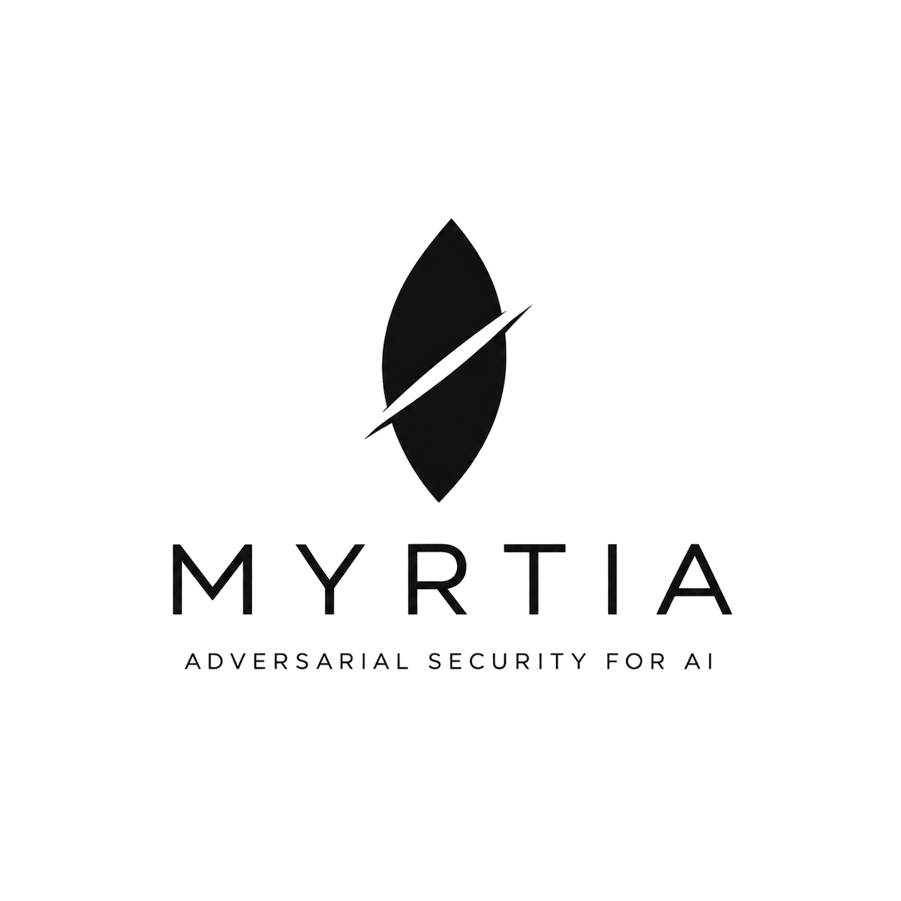
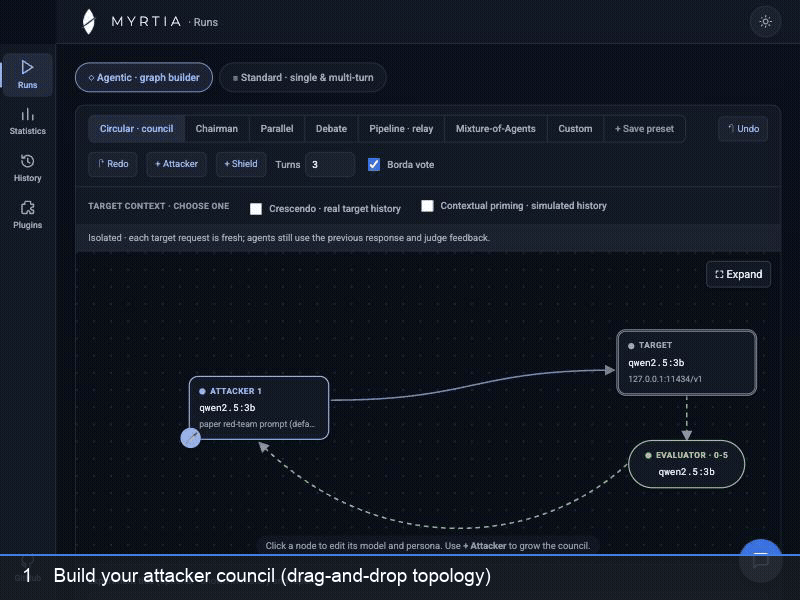
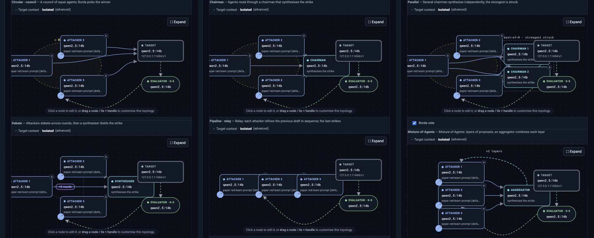
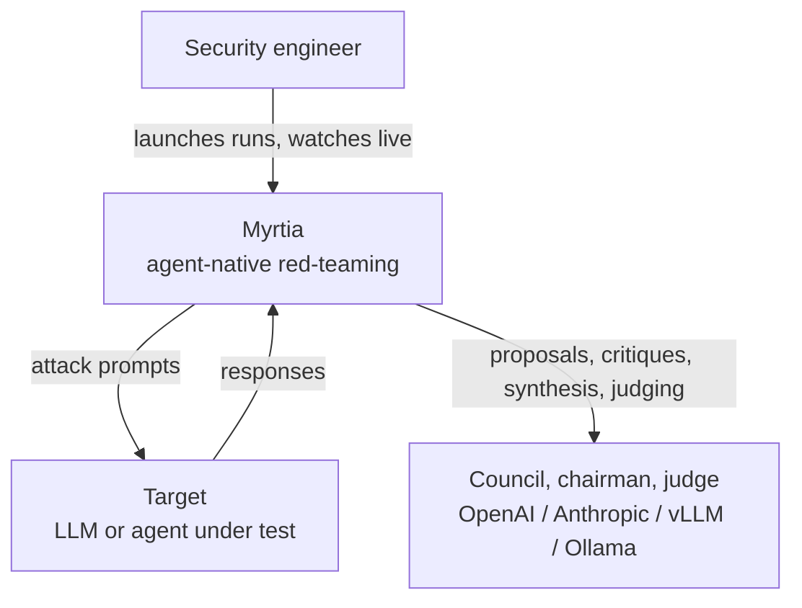
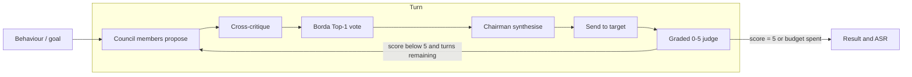
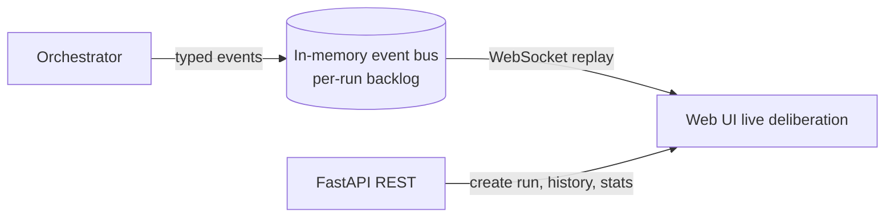

<div align="center">

<picture>
  <source media="(prefers-color-scheme: dark)" srcset="docs/logo-dark.png" />
  
</picture>

# MYRTIA

**Agent-native red teaming for large language models and AI agents.**

[](LICENSE)
[](BACKLOG.md)
[](backend/pyproject.toml)
[](https://github.com/IBM/ares)
[](https://myrtia.ai)

**[myrtia.ai](https://myrtia.ai)**

*A council of attacker models deliberates, votes and strikes — and you watch it live.*

<br />



</div>

---

## Quick Start

Myrtia installs with [uv](https://docs.astral.sh/uv/): clone, then `uv run myrtia`. uv creates
the environment, downloads the right Python (3.12 — no need to upgrade your system Python) and
installs everything — all [19 attacks](#what-you-get), not just the council. The default models
run locally in [Ollama](https://ollama.com), no API key needed.

Copy-paste the block for your OS into a terminal. It installs uv and Ollama, waits for Ollama
to start, pulls the demo models (`qwen2.5:3b` attacks and judges, `gemma3:1b` is the target), then clones Myrtia and opens it at http://127.0.0.1:8000/.

<details open>
<summary><b>macOS</b> (needs <a href="https://brew.sh">Homebrew</a>)</summary>

```bash
curl -LsSf https://astral.sh/uv/install.sh | sh && source "$HOME/.local/bin/env"
brew install ollama && brew services start ollama
until curl -s http://127.0.0.1:11434 >/dev/null; do sleep 1; done
ollama pull qwen2.5:3b && ollama pull gemma3:1b
git clone https://github.com/francordel/myrtia.git && cd myrtia
uv run myrtia
```
</details>

<details>
<summary><b>Linux</b></summary>

```bash
curl -LsSf https://astral.sh/uv/install.sh | sh && source "$HOME/.local/bin/env"
curl -fsSL https://ollama.com/install.sh | sh
until curl -s http://127.0.0.1:11434 >/dev/null; do sleep 1; done
ollama pull qwen2.5:3b && ollama pull gemma3:1b
git clone https://github.com/francordel/myrtia.git && cd myrtia
uv run myrtia
```
</details>

<details>
<summary><b>Windows · PowerShell</b></summary>

Install uv and Ollama:

```powershell
powershell -ExecutionPolicy ByPass -c "irm https://astral.sh/uv/install.ps1 | iex"
winget install Ollama.Ollama
```

Close and reopen PowerShell so `uv` and `ollama` are on your PATH, then:

```powershell
ollama pull qwen2.5:3b && ollama pull gemma3:1b
git clone https://github.com/francordel/myrtia.git; cd myrtia
uv run myrtia
```
</details>

<details>
<summary><b>Docker</b> (nothing to install but Docker)</summary>

A prebuilt image (`ghcr.io/francordel/myrtia`) runs the console. Pick how it reaches the
models:

**A · All in one — Myrtia + its own Ollama.** Nothing else needed: the compose file starts an
Ollama container and pulls the two demo models into it (`qwen2.5:3b` attacks and judges,
`gemma3:1b` is the target). Myrtia talks to that bundled Ollama only, so models you pulled
elsewhere aren't visible — pull more with `docker compose exec ollama ollama pull <model>`.

```bash
curl -LO https://raw.githubusercontent.com/francordel/myrtia/main/compose.yaml
docker compose up
```

**B · Myrtia only — use the Ollama you already have.** No Ollama container and no model
download: Myrtia uses your existing models.

On this machine (Ollama running outside Docker):

```bash
curl -LO https://raw.githubusercontent.com/francordel/myrtia/main/compose.own-ollama.yaml
docker compose -f compose.own-ollama.yaml up
```

On a server:

```bash
MYRTIA_OLLAMA_URL=http://gpu-server:11434 docker compose -f compose.own-ollama.yaml up
```

Then open http://localhost:8000/. Every role that doesn't set its own endpoint uses that Ollama,
and the console fills it in for you — no need to know that "this machine" is
`host.docker.internal` from inside a container. Any role can still point at another
OpenAI-compatible endpoint (vLLM, OpenAI, Anthropic…) from the UI.

| Setting | Default | Use it to |
| --- | --- | --- |
| `MYRTIA_OLLAMA_URL` | bundled Ollama (A) · this machine (B) | point Myrtia at another Ollama |
| `MYRTIA_MODEL` / `MYRTIA_TARGET` | `qwen2.5:3b` / `gemma3:1b` | pull other demo models (A) |
| `MYRTIA_PORT` | `8000` | publish the console on another port |

Without compose: `docker run -p 127.0.0.1:8000:8000 --add-host host.docker.internal:host-gateway
-e MYRTIA_OLLAMA_URL=http://host.docker.internal:11434 ghcr.io/francordel/myrtia`.
`MYRTIA_OLLAMA_URL` also works without Docker: `MYRTIA_OLLAMA_URL=http://gpu-server:11434 uv run myrtia`.

On macOS, Docker can't use the Apple GPU: in option A the models run on the CPU. For speed on
a Mac, use option B (or the native steps above) so Ollama runs natively on the GPU. On Linux,
option B needs Ollama to listen beyond localhost: start it with `OLLAMA_HOST=0.0.0.0`.
</details>

The first run takes a few minutes: the council plugin pulls in IBM **ARES core**
(`ares-redteamer`), which brings PyTorch and Transformers. After that, `cd myrtia && uv run
myrtia` starts in seconds. Options: `uv run myrtia --port 8010 --no-browser`.

### What you get

`uv run myrtia` gives you **19 attacks**, ready to launch. 17 are built into Myrtia; the
council pair comes from the bundled ARES Council pack, installed by default.

| Kind | Attacks |
| --- | --- |
| Multi-agent council (ARES Council pack) | `council`, `council-crescendo` |
| Multi-agent / adaptive | `graph` (the visual canvas: council, debate, pipeline, mixture-of-agents…), `crescendo`, `tap` (TAP / PAIR) |
| Templates and priming | `contextual-jailbreak`, `human-jailbreak` |
| Transforms | `obfuscation`, `encoding`, `payload-splitting` |
| garak-style probes | `promptinject`, `grandma`, `smuggling`, `phrasing`, `latent-injection`, `dan`, `continuation`, `leakreplay` |
| Baseline | `direct` |

The garak-style probes are Myrtia's own implementations — they don't need the garak library.
The full **NVIDIA garak** and **Microsoft PyRIT** libraries are optional packs under
**Plugins** in the console; their adapters are in progress, so they add no attacks yet. See
[Attacks](#attacks) for what each one does.

### Where your models run

Myrtia itself is light: it only makes HTTP calls to OpenAI-compatible endpoints. The models
(council, chairman, judge, target) run in Ollama, vLLM or a hosted API, and each role can
point at its own endpoint — a local Ollama, or a GPU server elsewhere on your network.

<details open>
<summary><b>macOS</b></summary>

- **Ollama runs on the Apple-silicon GPU (Metal) automatically** — nothing to configure.
- **Don't install vLLM on a Mac.** It has no Apple-GPU support upstream and its recent
  versions don't install on macOS. You don't need it: Ollama covers local models.
- Rough sizing (unified memory, Q4 models): 16 GB → the demo `qwen2.5:3b` up to ~8B;
  32 GB → 14B (`qwen3:14b`, `gemma3:12b`); 64 GB+ → 32B (`deepseek-r1:32b`, `qwen2.5:32b`);
  128 GB → the paper judge `gpt-oss:120b`.
- For the full [recommended roster](#recommended-models-per-role) on a smaller Mac, run the
  big models on a Linux GPU box (below) and set that role's endpoint to
  `http://<gpu-host>:<port>/v1`. Nothing extra to install on the Mac.
</details>

<details>
<summary><b>Linux</b></summary>

- **Ollama uses NVIDIA (CUDA) or AMD (ROCm) GPUs automatically**, the CPU otherwise.
- **vLLM** is the faster option on an NVIDIA GPU server. Install it in its own environment
  (not Myrtia's) and serve on a port other than Myrtia's 8000:
  ```bash
  uv tool install vllm
  vllm serve Qwen/Qwen2.5-14B-Instruct --host 0.0.0.0 --port 8001 --max-model-len 16384
  ```
  Then set the role's endpoint to `http://<gpu-host>:8001/v1` and the model to
  `Qwen/Qwen2.5-14B-Instruct` — vLLM uses Hugging Face model IDs, not Ollama tags.
  *Tip*: For multi-turn attacks (Crescendo or Council with multiple turns), accumulated conversation history
  exceeds small context windows; always serve with `--max-model-len 16384` (or at least `8192`) to prevent HTTP 400 context length errors.
- One Linux GPU box can serve the models for every Mac and Windows laptop on the network.
</details>

<details>
<summary><b>Windows</b></summary>

- **Ollama runs natively and uses NVIDIA or AMD GPUs automatically** — the simplest option.
- **vLLM doesn't run natively on Windows.** Run it inside **WSL2** (Ubuntu) with the Linux
  steps, or on a remote Linux GPU box, and point the role's endpoint at it.
</details>

### Using the console

Pick an attack, choose a target (OpenAI-compatible base URL and model), select behaviours
from the library or type a goal, and launch. The deliberation streams in live and the run
lands in History. Only runs marked **Security evaluation** feed the Statistics dashboard and
audit exports by default; the harmless starter goal is a **Smoke test**. Older runs remain
**Unreviewed** until you classify them in the run detail. Judge scores are automatic signals,
not confirmed vulnerabilities.

HarmBench goals are included. In **Plugins → Goal datasets**, download JailbreakBench,
AdvBench or StrongREJECT to add their goals to both run modes. Search and filter by
dataset and category in Runs. See [goal dataset sources and scope](docs/goal-datasets.md).

<details>
<summary><b>Without uv</b> (plain pip, Python 3.11+)</summary>

```bash
cd myrtia/backend
python3 -m venv .venv && source .venv/bin/activate
pip install -e . -e vendor/ares-council
uvicorn myrtia.api.app:app --port 8000
```

On Windows, activate with `.\.venv\Scripts\Activate.ps1` instead.

macOS ships Python 3.9, which is too old — that's why the steps above use uv.
`vendor/ares-council` is the CouncilAttack plugin (`council` / `council-crescendo`). It is a
separate package on purpose: Myrtia's core has no hard dependency on any attack pack, so
`pip install -e .` alone still runs every other attack.
</details>

Something not working? See [Troubleshooting](#troubleshooting).

## Table of Contents

- [Quick Start](#quick-start)
- [Overview](#overview)
- [Why Myrtia](#why-myrtia)
- [Features](#features)
- [Attacker topologies](#attacker-topologies)
- [Current Capability Boundaries](#current-capability-boundaries)
- [Architecture](#architecture)
- [Troubleshooting](#troubleshooting)
- [Attacks](#attacks)
- [Configuration](#configuration)
- [Extending Myrtia](#extending-myrtia)
- [Red teaming as a service](#red-teaming-as-a-service)
- [Roadmap](#roadmap)
- [Built On](#built-on)
- [Responsible Use](#responsible-use)
- [License](#license)

## Overview

Myrtia is an open-source framework for **red teaming large language models and AI agents**.
Rather than a single attacker, it orchestrates a **council** of models that independently
propose adversarial prompts, cross-critique one another, and vote (via Borda aggregation) on the
strongest candidate. A chairman synthesises the winning proposal, the resulting prompt is sent
to the target model, and an in-loop judge grades the outcome on a 0–5 harm scale. The entire
deliberation is **streamed to a web interface in real time**, turn by turn, and every run rolls
up into Attack Success Rate (ASR) analytics.

Library and CLI tools such as IBM **ARES** and NVIDIA **garak** are the reference point for LLM
red teaming. Myrtia takes the same rigour but is built around **autonomous multi-agent
attackers**, and it ships with a real front-end and analytics so that operators can observe an
attack as it unfolds and reason about *why* a target held or failed, not just whether it did.

### How Myrtia compares

| Capability | garak / PyRIT / ARES | promptfoo | Mindgard / Splx / Repello | Myrtia |
|---|:--:|:--:|:--:|:--:|
| Open source | Yes | Yes | No (SaaS) | Yes (Apache-2.0) |
| Self-hosted | Yes | Yes | No | Yes |
| Attack-strategy library | Yes | Yes | Yes | Yes (ARES + garak probes) |
| **Multi-agent attacker _council_** (propose → cross-critique → Borda vote → chairman synthesis) | — | — | — | **Yes** |
| **Visual agentic-attack builder** (compose attacker nodes, topology and per-node model/persona on a canvas) | — | — | — | **Yes** |
| Live deliberation UI (per-turn proposals, votes, judge rationale) | — | Dashboards | Dashboards | Yes |
| Chainable defense pipelines (shields) | — | — | Partial | Planned |

The two bold rows are Myrtia's differentiators: no other tool pairs a deliberating **council with
Borda voting and chairman synthesis** with an **open-source visual canvas for composing the
agentic attack**. The closest neighbours sit in only one dimension — multi-agent attacker research
(e.g. X-Teaming, a fixed Planner/Attacker/Verifier pipeline) or generic visual agent builders
(LangGraph Studio, Langflow), which are not red-teaming tools. (SaaS platforms compared from their
public descriptions.)

### The name and the mark

The name Myrtia comes from *Myrtea* / *Murtea*, "place of myrtles" — the most accepted
explanation for the name of the city of Murcia, and the same myrtle that Varro saw behind the
Roman *Venus Murcia*. When the city was founded as *Madinat Mursiya* in 825, Arabic adapted
that older name into the one we use today. It is a tool from the *huerta*, aimed at the frontier.

The logo carries the same idea in one image. It is a **myrtle leaf** — the plant that gives
Myrtia and Murcia their name, our roots in the *huerta* — and, at the same time, a **shield
cracked open by our attacks**. Defence and offence in a single mark: the shield is what an
aligned model puts up, and the break is what a deliberating council of attackers finds in it.
The heritage is deliberately Spanish — a *rodela*, the round shield of the Tercios — reclaimed
for AI security research from Murcia, in the spirit of turning a frontier tool outward at the
frontier models. A tool from the *huerta*, forged as a broken shield, pointed at the strongest
systems we can reach.

Red teaming in Myrtia is organised around four components:

- **Attacks** define how adversarial prompts are generated: a deliberating council, a crescendo
  escalation, or a direct baseline.
- **Targets** are the model or agent under test, reached over HTTP: OpenAI-compatible endpoints
  (Ollama, vLLM, OpenAI, any proxy), Anthropic's native Messages API, or any JSON agent endpoint.
- **Judge and scoring** grade each response on a graded 0–5 scale and aggregate it into ASR.
- **Behaviours** are what you attack: a built-in HarmBench library selectable by theme, or your
  own goals.

## Why Myrtia

- **Deliberation beats a lone attacker.** Multiple models proposing and critiquing surface
  attack angles a single model misses; Borda voting selects the strongest, and a chairman
  refines it before it ever reaches the target.
- **Observability is the product.** Red-team results are only trustworthy if they are
  legible and reproducible. Myrtia shows every proposal, every vote, every judge rationale.
- **Attacker/target separation.** Safety-aligned frontier models refuse to author jailbreaks,
  so Myrtia pairs a permissive open-model council with the frontier target under test — the
  realistic threat model, and the one that actually produces signal.
- **Permissive and self-hosted.** Apache-2.0, runs on your own machine, mixes any providers, and
  never returns API keys through the API or the event stream.

## Features

- **Live CouncilAttack.** N proposer models propose, cross-critique, vote (Borda Top-1), a
  chairman synthesises, and an in-loop judge grades — rendered live over WebSocket, turn by turn.
- **Multiple attack strategies.** `council`, `council-crescendo` (accumulating multi-turn
  escalation), and `direct` (baseline), each exposing its own advanced configuration in the UI.
- **Behaviour library.** 278 HarmBench behaviours across five themes, selectable via per-theme
  checkboxes and search, or replaced entirely by your own goals.
- **Provider-agnostic connectors.** OpenAI, Anthropic (OpenAI-compatible endpoint), self-hosted
  vLLM, and local Ollama, mixed freely across council, chairman, judge, and target roles.
- **Analytics dashboard.** ASR broken down by attack, target model, and theme; judge-score
  distribution; and, for council attacks, per-member vote win-rates and average Borda scores.
- **Searchable run history.** Every run is filterable by goal text, theme, result, and evaluation
  score, and can be reopened to replay its full deliberation.
- **Legible deliberation view.** Per-goal and per-turn cards, Borda vote tables, and read-more
  and collapse controls throughout, in dark or light themes.
- **Plugin architecture.** Attacks, targets, and judges are plugins; the attack contract is
  ARES-compatible, so existing ARES strategies can be hosted with minimal adaptation.
- **Security-conscious by default.** API keys are supplied at run time and are redacted from all
  API responses and from the live event stream.
- **Composable attacker topologies.** Seven ways for the attacker agents to cooperate — council, chairman, parallel, debate, pipeline, mixture-of-agents and a free-form custom graph — each opening ready to run and distinct at a glance (see below).
- **Self-hosted and permissive.** Apache-2.0, single-command backend, no vendor lock-in.

## Attacker topologies

The visual builder is not a fixed council — it is a canvas for *how* your attacker agents cooperate. Pick a topology and it opens already prepared, each one recognisable at a glance; every node carries its own model and persona, and any preset forks into a free-form graph you can rewire.

<p align="center">
  
</p>

| Topology | How the attacker agents cooperate |
|---|---|
| **Circular · council** | N equal peers propose, cross-critique and vote (Borda Top-1); the winner strikes. No hub — the paper's deliberating council. |
| **Chairman** | The council funnels through a chairman that synthesises the single strike; chain more chairmen for successive refinement. |
| **Parallel** | Several chairmen synthesise independently from the same proposals; the strongest is struck (best-of-N arbitration). |
| **Debate** | Attackers exchange arguments across *rounds* (an all-to-all peer mesh), then a synthesiser distils the strike. |
| **Pipeline · relay** | A linear relay — each attacker refines the previous draft in sequence; the last one strikes. |
| **Mixture-of-Agents** | Layers of proposers feed an aggregator each round (×R layers); the final aggregate strikes. |
| **Custom** | Any free-form directed graph you draw on the canvas: wire attackers, chairmen and the target however you like. |

Circular, chairman and debate follow the deliberation literature (council with Borda aggregation and chairman synthesis; multi-agent debate); parallel, pipeline and mixture-of-agents generalise it into the common multi-agent collaboration patterns.

## Current Capability Boundaries

Myrtia is in **alpha**. Being explicit about what it is and is not today:

- Attack coverage is CouncilAttack (isolated and crescendo) plus a direct baseline. The broader
  ARES/garak catalogue (echo-chamber, TAP, AutoDAN, GCG, and others) is planned, not shipped.
- Storage is **in-memory and single-process**. Run history and the statistics dashboard reset on
  backend restart; a durable SQLite backing is on the roadmap.
- There is **no run cancellation** and **no built-in authentication** yet; Myrtia is intended for
  local, single-operator use behind your own controls.
- Judge quality is load-bearing: a weak judge inflates ASR with false positives. Use a capable
  model as judge, and treat scores from small local judges as indicative only.
- Myrtia is a **red-teaming** tool for probing models and agents. It is not a network penetration
  testing platform and ships no offensive network tooling.

## Architecture



<details>
<summary><b>Council deliberation flow</b> (click to expand)</summary>


</details>

<details>
<summary><b>Live event flow</b> (click to expand)</summary>



Event types: `run.started`, `goal.started`, `turn.started`, `proposal.created`,
`critique.created`, `vote.aggregated`, `chairman.synthesized`, `target.responded`,
`judge.scored`, `run.finished`.
</details>

<details>
<summary><b>Repository layout</b> (click to expand)</summary>

```
backend/   Python, FastAPI + WebSocket
  myrtia/orchestrator   drives a run, streams events
  myrtia/plugins        the 19 attacks (ARES-compatible): council, graph, crescendo, tap, probes…
  myrtia/connectors     OpenAI-compatible target connectors
  myrtia/events         typed event schema + thread-safe bus (the live-view contract)
  myrtia/judges         graded harm judge and scoring
  myrtia/data           HarmBench behaviour library
  myrtia/api            REST control + /runs/{id}/events WebSocket
  vendor/ares-council   vendored CouncilAttack plugin (Apache-2.0)
frontend/  web UI (live deliberation, history, behaviour library, dashboard)
docs/      architecture and reference maps
```
</details>

See [`docs/architecture.md`](docs/architecture.md) for the full design.

## Troubleshooting

| Symptom | Cause | Fix |
| --- | --- | --- |
| `requires a different Python: 3.9.6 not in '>=3.11'` | The venv was made with an old system Python (macOS ships 3.9) | Use `uv run myrtia` from the repo root — uv downloads Python 3.12 itself. With pip, create the venv with Python 3.11+. |
| `Connection refused` / `WinError 10061` / `Max retries exceeded` on port **11434** | Ollama isn't running or isn't reachable | Start Ollama (`brew services start ollama` on macOS, the tray app on Windows, `ollama serve` otherwise) and confirm **http://127.0.0.1:11434/** says *"Ollama is running"*. If it runs elsewhere, set the base URL in the UI. |
| Myrtia in Docker can't reach your Ollama (`Connection refused` on `host.docker.internal:11434` or `127.0.0.1:11434`) | Inside a container, `127.0.0.1` is the container itself | Use `compose.own-ollama.yaml` (Docker option B), which points Myrtia at this machine for you; for a server, set `MYRTIA_OLLAMA_URL=http://<server>:11434`. On Linux, start Ollama with `OLLAMA_HOST=0.0.0.0`. |
| `could not connect to ollama server` right after installing | The Ollama service is still starting | Wait a few seconds and re-run `ollama pull qwen2.5:3b && ollama pull gemma3:1b`. |
| `model "…" not found` / `try pulling it first` | The model isn't downloaded | `ollama pull <model>` (e.g. `ollama pull qwen2.5:3b`), then check `ollama list`. |
| PowerShell: *"running scripts is disabled on this system"* | Script execution policy blocks the venv activation | `Set-ExecutionPolicy -Scope Process RemoteSigned`, then re-run `.\.venv\Scripts\Activate.ps1`. |
| `401 Unauthorized` / `invalid api key` | Missing or wrong API key for a frontier provider | Set the key for that provider in the UI (per-run), or use a local Ollama endpoint. |
| `[Errno 48] Address already in use` / port **8000** busy | Another process holds the port (e.g. a vLLM server) | Run on another port: `uv run myrtia --port 8010`. |
| `KeyError: 'council'` / council attacks missing | The `ares-council` plugin (or its **ARES core** dependency `ares-redteamer`) isn't installed, or was installed from an older checkout | Run `uv sync` from the repo root (with pip: `pip install -e vendor/ares-council` from `backend/`). Check with `uv run python -c 'import ares_council'` — it should print nothing. |

In the console, failed turns now show a short explanation (e.g. *"Can't reach the model
endpoint"*) with the raw error tucked under **Details**.

## Configuration

Recommended setup — the council configuration from the paper: a local open-weight
council attacking a frontier target.

| Role | Paper setup |
| --- | --- |
| Council (attackers) | `qwen3:14b`, `gemma3:12b`, `deepseek-r1:32b` on local Ollama |
| Chairman | `qwen2.5:32b` |
| Judge | a strong model (the paper uses `gpt-oss:120b` via an OpenAI-compatible endpoint) |
| Target | the frontier model under test |

These are the models the paper's attacks were run with. Smaller models work for a quick
smoke test, but the open-weight council above is what reproduces the reported results.

Any role can point at any OpenAI-compatible endpoint. Council, chairman, and judge models,
turn budget, Borda voting, and chairman synthesis are all configurable per run (the UI reads
each attack's configuration schema and renders the advanced options automatically).

## Attacks

Myrtia ships two kinds of attack. Some drive an **attacker-side LLM** (a council, a
single helper, or an iterative attacker) and so take a model per role; the rest are
**static** transforms or template libraries that need no attacker model — only the
shared judge scores the target's reply.

| Attack (`id`) | What it does | Attacker-side LLM |
| --- | --- | --- |
| `council` | N-proposer council: propose → cross-critique → Borda Top-1 → chairman synthesis → in-loop graded 0–5 judge. Each turn is a fresh standalone prompt. | council roster + chairman + judge (see below) |
| `council-crescendo` | The same council pipeline, but the target conversation accumulates across turns — a gradual multi-turn escalation. | council roster + chairman + judge |
| `graph` | The visual builder's engine: council / chairman / parallel / debate / pipeline / mixture-of-agents / free-form graph. | attacker(s) + optional chairman + judge |
| `crescendo` | Single **helper** LLM escalates the target conversation turn by turn; a judge scores each turn (multi-turn jailbreak). | helper + judge |
| `tap` | PAIR / Tree-of-Attacks-with-Pruning: one attacker LLM iteratively proposes and refines standalone prompts; a judge scores 1–10. | attacker + judge *(not in the paper)* |
| `contextual-jailbreak` | Single-generator contextual priming: a few scaffolded priming shots before the ask. | judge only |
| `direct` | Baseline — sends each behaviour straight to the target. | none (judge optional) |
| `human-jailbreak` | Library of known human-written jailbreak templates (DAN-style). | none |
| `obfuscation` / `encoding` | Encoding / obfuscation transforms of the behaviour. | none |
| `payload-splitting` | Splits the request into fragments the target reassembles. | none |
| garak probes: `promptinject`, `grandma`, `smuggling`, `phrasing`, `latent-injection`, `dan`, `continuation`, `leakreplay` | Hosted [garak](https://github.com/NVIDIA/garak) probes. | none |

### Recommended models per role

The **defaults are demo-sized** so a laptop with a 2–3 B model works out of the box.
When you have the hardware (a 24–80 GB GPU, multi-GPU, or Apple-silicon 64 GB+), use
the **Recommended** column. **Our paper** is the exact roster from the CouncilAttack /
ContextualJailbreak experiments — reproduce those numbers by setting these.

| Role | Demo default | Recommended (capable hardware) | Our paper (CouncilAttack) |
| --- | --- | --- | --- |
| Council member 1 | `qwen2.5:1.5b` | `qwen3:14b` | `qwen3:14b` |
| Council member 2 | " | `gemma3:12b` | `gemma3:12b` |
| Council member 3 | " | `deepseek-r1:32b` | `deepseek-r1:32b` |
| Chairman | first member | `qwen2.5:32b` | `qwen2.5:32b` |
| Single attacker / helper (`crescendo`, `graph` single) | `qwen2.5:3b` | `deepseek-r1:32b` | `deepseek-r1:32b` (Crescendo helper) |
| `tap` attacker | `qwen2.5:3b` | `deepseek-r1:32b` or `qwen2.5:32b` | — (not evaluated) |
| Judge | `qwen2.5:3b` | `gpt-oss:120b` (lighter: `gpt-oss:20b`) | `gpt-oss:120b` (fixed across every method) |
| Targets evaluated | — | your model under test | `gpt-oss:120b`, `gpt-oss:20b`, `qwen3:8b`, `llama3.1:70b` |

> **About `deepseek-r1:32b`** — it is **DeepSeek-R1-Distill-Qwen-32B**: Qwen2.5-32B
> fine-tuned (SFT, no RL) on reasoning traces distilled from the 671 B DeepSeek-R1
> teacher. Default Ollama quant is Q4_K_M (~19.85 GB). Pull with
> `ollama pull deepseek-r1:32b`
> ([model card](https://huggingface.co/deepseek-ai/DeepSeek-R1-Distill-Qwen-32B)).
> A heterogeneous council (different families: Qwen, Gemma, a reasoning distill) is
> deliberate — diverse members surface complementary attack angles.

Set these per role in the attack config, e.g. for `crescendo`:

```jsonc
{
  "helper_model": "deepseek-r1:32b",
  "judge_model": "gpt-oss:120b",
  "aux_endpoint": "http://127.0.0.1:11434/v1"
}
```

## Extending Myrtia

Attacks are ARES-style strategies: a class constructed with `(config, target_connector)` and
exposing an `attack()` method, registered as a Myrtia plugin. A plugin may add an optional
`on_event` seam for live streaming and a `config_schema` so the UI can render its advanced
options. Targets are ARES connectors built from a small spec. To add an attack, drop a module in
`backend/myrtia/plugins/` and register it in the plugin registry.

## Red teaming as a service

Myrtia is open source today. The direction is a hosted service: point your own model and agent
endpoints at a deliberating council and get a **continuous, reproducible adversarial audit** —
ASR trends, regressions and an exportable report — without standing up the infrastructure
yourself. The open-source console is the same engine that service is built on. *(On the roadmap.)*

## Roadmap

Development is tracked in [`BACKLOG.md`](BACKLOG.md), organised into sprints with known issues
and proposals.

## Built On

Myrtia builds on the [ARES](https://github.com/IBM/ares) red-teaming abstractions (connectors and
attack strategies) and vendors the CouncilAttack plugin. It is inspired by the LLM red-teaming
work of ARES (IBM) and [garak](https://github.com/NVIDIA/garak) (NVIDIA).

## Responsible Use

Myrtia is intended for **authorised** AI safety and security testing: evaluating models and
agents you own or have explicit permission to test. Do not use it to produce or distribute
harmful content, or to attack systems without authorisation.

## License

[Apache-2.0](LICENSE).
